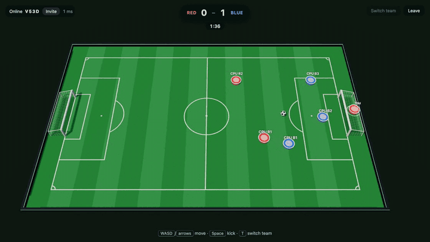
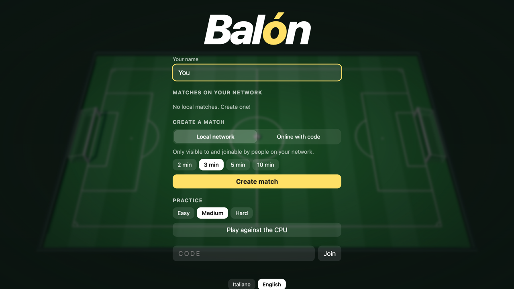
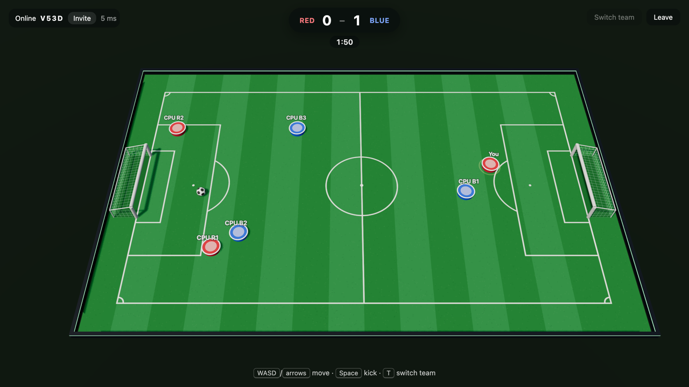
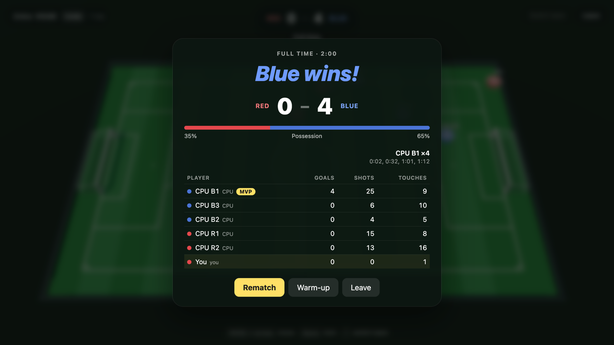

# Balón

Multiplayer disc football in the browser, with a tilted 3D view.



| Home | Match | Full time |
| --- | --- | --- |
|  |  |  |

## Getting started

```sh
pnpm install
pnpm dev      # game server on :3001 + Vite on :5173
```

Open http://localhost:5173 (more tabs = more players; on the same network it also works with the machine's IP).

## Matches

- **Local network**: listed for, and joinable only by, people on the same network as whoever created it
  (same public IP as seen by the server; if the server runs on a LAN, every private IP counts as the same network).
- **Online with code**: not listed; you join with the 4-letter code or the invite link (`?p=CODE`).

Whoever creates the match is the host: they pick the length, start it, and can add CPU players
to either team (Easy, Medium, Hard). "Play against the CPU" on the home screen creates a private match against a bot;
if a room is full, a person who joins takes a bot's place. A draw at full time goes to golden goal.
When the match ends, play stops and a summary appears (scorers, possession, stats, MVP);
the host chooses between a rematch and warm-up. If nobody takes the kick-off within 5 seconds, play starts anyway.
A name is required to join. Once the match has started you can only switch teams to rebalance them (see Controls).
If you drop out (reload, app in the background, network) you have 20 seconds to get your spot back.

The home screen can install the game as an app (PWA): an "Install" button where the browser supports it
(it needs HTTPS or localhost), and Share-menu instructions on iOS.

The UI is available in Italian and English: it follows the browser language (English by default),
and there is a switcher at the bottom of the home screen. Strings live in `client/i18n.ts`.

Behind a reverse proxy, set `TRUST_PROXY=1` so the server reads the real IP from `X-Forwarded-For`.

Single build served by the game server:

```sh
pnpm build && pnpm start   # http://localhost:3001
```

## Controls

- **WASD / arrows**: move
- **Space / X**: kick (hold it and the kick fires on contact)
- **T**: switch team (once the match has started, only if your team has at least 2 more players than the other, not counting players who are offline)
- **Mobile**: stick on the left (it appears where you put your thumb), KICK button on the right

## Structure

- `shared/game.ts`: fixed-step simulation (60 ticks/s), disc physics, kicking, goals
- `shared/protocol.ts`: client ↔ server messages
- `server/hub.ts`: authoritative game server, independent of the transport: rooms, sessions and reconnection, the fixed-step loop
- `server/index.ts`: serves the hub with Bun (development, self-hosting); `server/worker.ts`: the same hub on Cloudflare
- `server/rooms.ts`, `server/network.ts`: rooms and detecting the client's network
- `server/bot.ts`: CPU players; they produce the same input as a human (stick + kick)
- `client/`: Three.js rendering, snapshot interpolation, lobby, HUD, keyboard/touch input, synthesized audio, i18n
- `scripts/icons.ts`: generates the favicon and PWA icons in `client/public/` (`pnpm icons`)

## License

[MIT](LICENSE)
